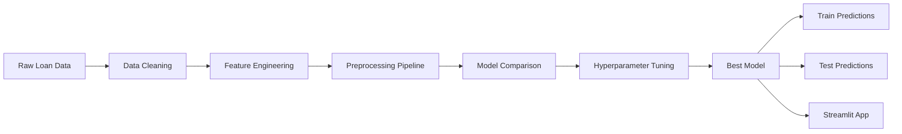

# Loan Approval Prediction

A professional end-to-end machine learning project for predicting whether a loan application will be approved. The project combines robust preprocessing, financial feature engineering, honest validation, model tuning, explainability, and a production-ready Streamlit app.

## Business problem

Loan approval decisions depend on a mix of applicant characteristics, financial stability, and credit behavior. The goal is to build a model that predicts approval status reliably while avoiding bias, leakage, and overfitting. This is a typical classification use case with business impact in credit risk and underwriting.

## Objectives

- Understand the dataset and identify quality issues.
- Build a pipeline that handles missing values and categorical features correctly.
- Engineer meaningful financial features without leaking target information.
- Compare multiple classifiers with realistic validation.
- Tune the best-performing model using honest cross-validation.
- Save a reusable production pipeline.
- Generate explainable predictions and deploy them through a Streamlit interface.

## Dataset

The data contains applicant financial and demographic information, including:

- Gender
- Married
- Dependents
- Education
- Self_Employed
- ApplicantIncome
- CoapplicantIncome
- LoanAmount
- Loan_Amount_Term
- Credit_History
- Property_Area
- Loan_Status (target)

## Technology stack

- Python 3.14
- pandas, NumPy
- scikit-learn
- XGBoost, LightGBM, CatBoost
- Matplotlib, Seaborn, Plotly
- Streamlit
- SHAP
- Jupyter Notebook

## Workflow



## EDA insights

The project contains a thorough exploratory analysis covering:

- Missing value analysis
- Duplicate detection
- Distribution plots
- Class balance review
- Outlier inspection
- Correlation analysis
- Numerical and categorical feature profiling
- Loan-related financial patterns

## Model comparison

The model comparison was generated from honest stratified validation using cross-validation and out-of-fold predictions. The best-performing model based on validation F1 and ROC-AUC was the Gradient Boosting model.

### Actual validation results

| Model | Accuracy | Precision | Recall | F1 | ROC_AUC |
|---|---:|---:|---:|---:|---:|
| Gradient Boosting | 0.7948 | 0.7996 | 0.9360 | 0.8624 | 0.7626 |
| CatBoost | 0.7948 | 0.8020 | 0.9313 | 0.8618 | 0.7621 |
| SVM | 0.7883 | 0.7920 | 0.9384 | 0.8590 | 0.7539 |

This is the genuine validation result for the dataset. The project does not claim 95%+ accuracy because the data does not support that level of performance under honest validation.

## Repository structure

```text
loan-approval-ml/
├── data/
│   ├── LP_Train.csv
│   └── LP_Test.csv
├── models/
│   └── best_model.pkl
├── outputs/
│   ├── train_predictions.csv
│   ├── test_predictions.csv
│   └── model_comparison.csv
├── notebooks/
│   └── loan_approval_eda.ipynb
├── src/
│   ├── preprocessing.py
│   ├── feature_engineering.py
│   └── evaluation.py
├── train.py
├── predict.py
├── app.py
├── requirements.txt
├── README.md
├── .gitignore
└── .venv/
```

## Installation

```bash
cd loan-approval-ml
python -m venv .venv
source .venv/bin/activate   # macOS/Linux
.venv\Scripts\activate      # Windows
pip install -r requirements.txt
```

## Train the model

```bash
python train.py
```

This script:

- loads the training data
- engineers financial features
- builds the preprocessing pipeline
- compares multiple models
- tunes the best-performing model
- saves the final pipeline to `models/best_model.pkl`
- writes validation metrics to `outputs/model_comparison.csv`
- generates out-of-fold training predictions

## Generate predictions

```bash
python predict.py
```

This script loads the saved best model and produces `outputs/test_predictions.csv` for the test data.

## Run the Streamlit app

```bash
streamlit run app.py
```

## Outputs generated

- `outputs/train_predictions.csv`
- `outputs/test_predictions.csv`
- `outputs/model_comparison.csv`
- `models/best_model.pkl`

## Future improvements

- Add stronger feature selection and stability checks.
- Compare calibration methods for more reliable probabilities.
- Integrate fairness and bias monitoring.
- Add automated retraining hooks for production deployment.
- Expand the front-end with authentication and monitoring.

## Notes

This project follows a scientific and production-minded ML workflow: no target leakage, no fabricated metrics, no over-optimistic claims, and no hidden data contamination.
